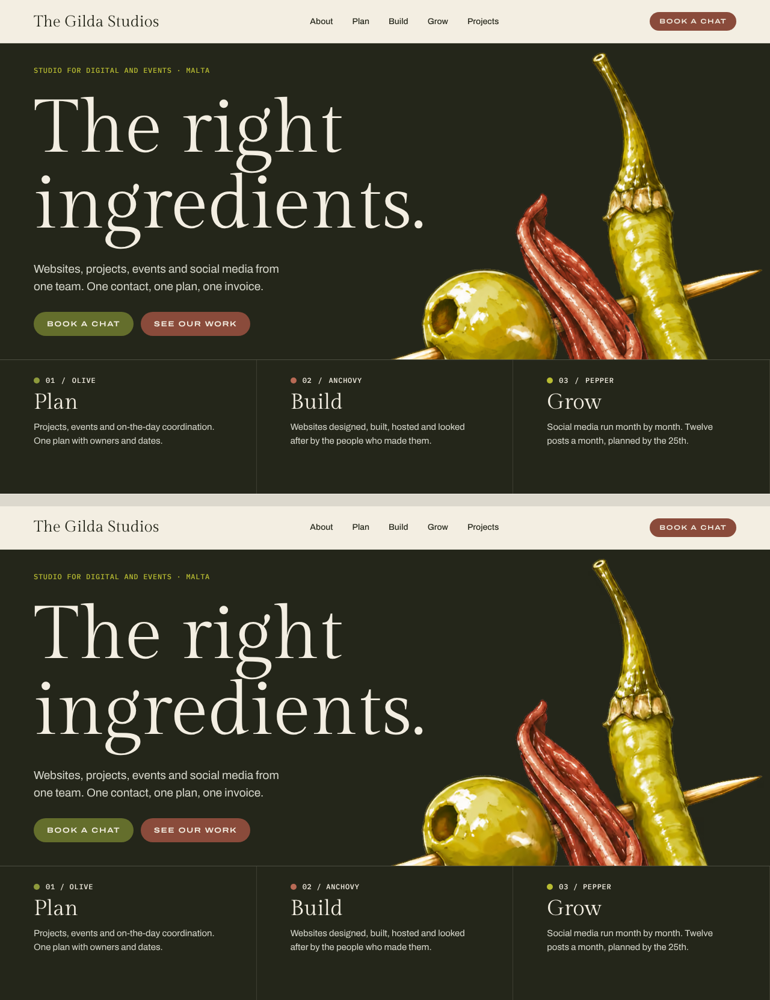
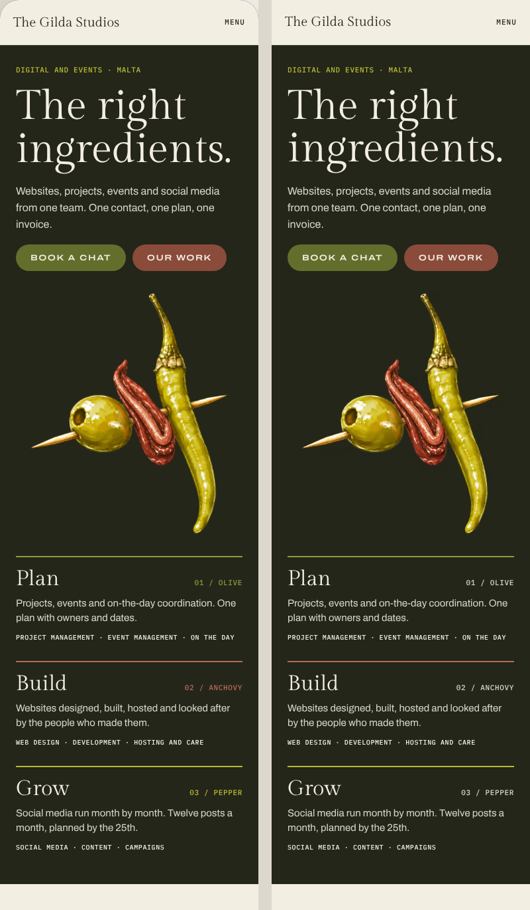
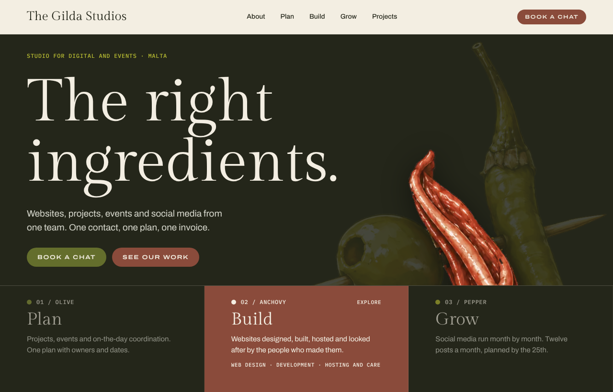
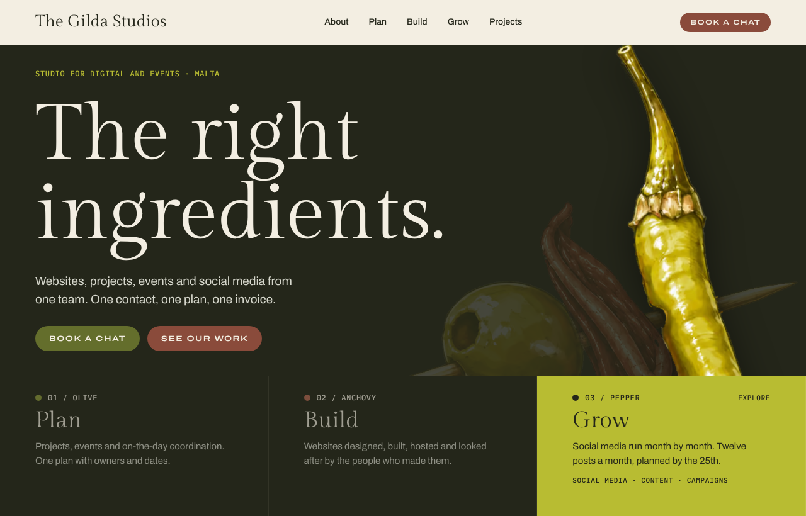
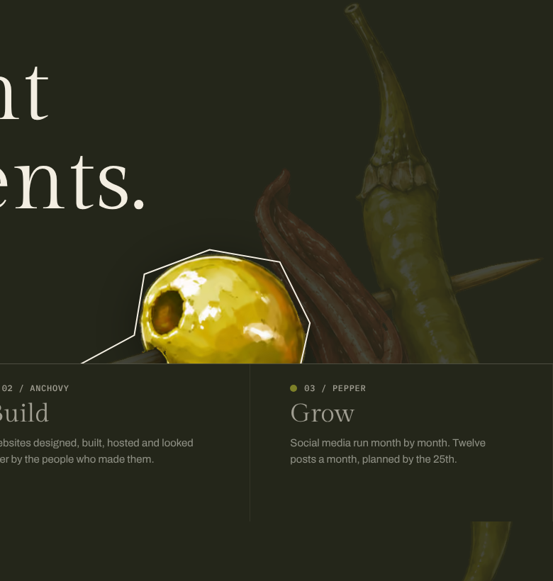

# Hero and branch strip checks (#15, #17)

Local production build, checked in Chromium (Playwright) at 1280 and 390 on
22 October 2026. Preview: `/dev/hero/`.

## Against the artboards

At 1280 the Homepage 2a hero is above and the build below. At 390 the design
is on the left and the build on the right.

On phone, the `01 / OLIVE` labels are Cream 2 instead of the branch tints. The
anchovy tint is 3.8:1 on Brine, below AA for 11px text. The tints stay on the
2px rules.

## Interaction

Pointer positions come from pixels of `mark-piece-map.png`.

- Pointing at the olive, the anchovy or the pepper lights only that piece. The
  base mark drops to 0.15 and the pointer cursor shows. The matching strip
  column fills with its branch colour and the others dim.
- The skewer and the gaps light nothing and keep the default cursor. Leaving
  the mark resets it.
- Hovering or focusing a strip column lights its piece.
- Tab reaches the three keyboard controls in the order olive, anchovy, pepper.
  Each lights its piece on focus, sets `aria-pressed`, and draws its polygon as
  a Cream focus outline. Enter and Space toggle it.
- On phone, a tap lights a piece. Tapping it again, a gap or anywhere outside
  the mark clears it.
- Under reduced motion there is no scale and no fade; the highlight switches
  instantly.
- The page has one `<h1>`. The mark images have reserved dimensions, and the
  page has no layout shift at load or during interaction. The earlier
  0.00004–0.00009 shift from the Archivo Expanded button font swapping in is
  gone now that `Base.astro` preloads that font.
- The island JavaScript is 1.8 KB gzipped: 1.1 KB for the mark, 0.45 KB for the
  strip and 0.2 KB for the shared state.

## Contrast

The design dims inactive strip columns to 0.45. At that opacity Cream 2 text on
Brine is 3.3:1 and fails AA. At 0.6 the line text is 4.8:1 and the labels are
5.7:1, so the build uses 0.6. Active columns are Cream on olive (4.8:1), Cream
on anchovy (5.8:1) and Brine on pepper (7.5:1).
