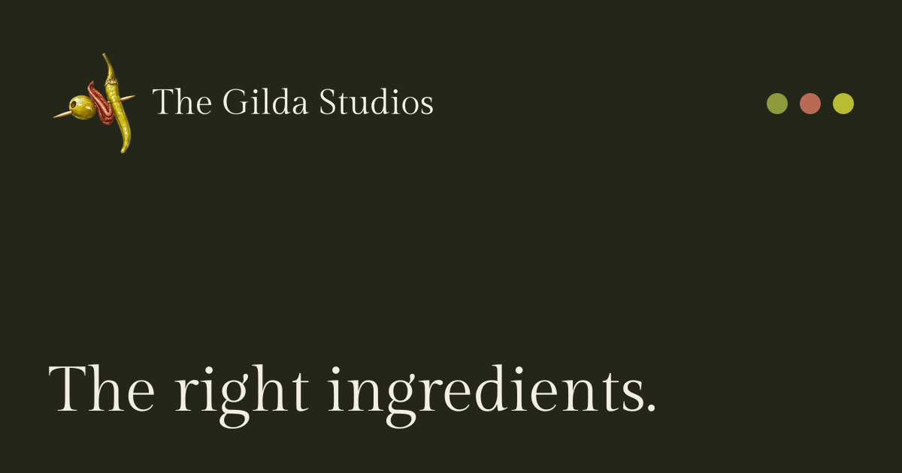
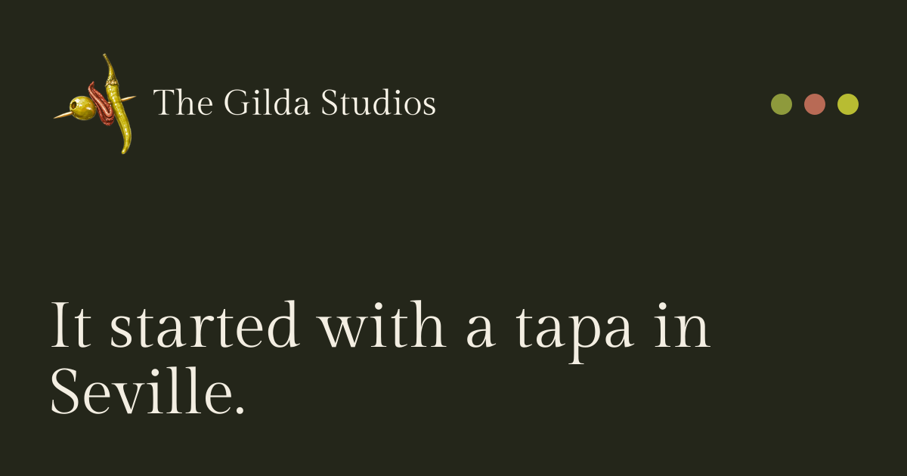
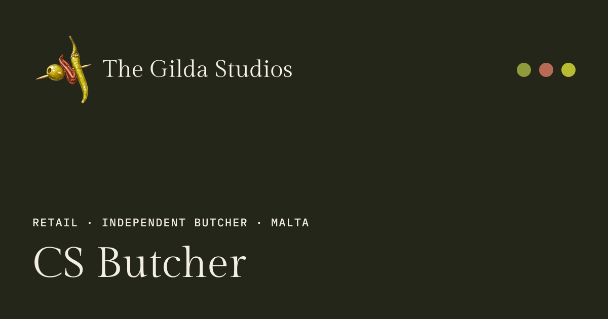

# SEO and social previews (#28)

## Local verification

- All eight public pages have unique titles, descriptions and production
  canonicals, `en-MT` / `en_MT`, matching Open Graph/Twitter metadata and
  generated 1200×630 PNGs. The homepage uses the specified title exactly.
- Sitemap index resolves to a sitemap with exactly those eight pages. No
  admin/API, development, system, image or draft routes are listed.
- Organization and LocalBusiness JSON-LD parse on every page. Published case
  studies have ordered three-level breadcrumbs. Blank social profiles, address
  details and confirmed phone are omitted rather than invented. The address
  currently identifies only Malta; Google eligibility remains unverified.
- Favicons match the GS tile at 16px and 32px; the touch and manifest icons
  match the approved app-icon asset at 180px, 192px and 512px.
- Artwork was visually inspected at its native dimensions. A canvas sizing
  issue found in the first pass was fixed; CI now checks clear space along all
  four edges to catch clipping. No public-page layout or design source changed.
- A separate preview build with temporary content verified `noindex`, robots,
  switching the production origin, blank-field defaults, and exclusion of a draft
  from pages, cards and sitemap. Temporary content was restored afterward.
- Type checking, lint, formatting, static build and `test:seo` pass.

## Artwork samples

The source reference is `design/readme.md` → Visual foundations and Logo rules;
the issue specifies the 1200×630 format. There is no page artboard for these
social cards. These are build output samples, not Netlify screenshots.

Favicons at actual size: 

## Pending deployed checks

- [ ] Inspect the cards on the Netlify Deploy Preview.
- [ ] Facebook Sharing Debugger and LinkedIn Post Inspector for home, about,
      services, projects and one case study.
- [ ] Google Rich Results Test after Chris supplies the approved business
      details. Local schema parsing does not replace that test.
- [ ] Confirm `en-MT` / `en_MT`, social profiles, address and phone.
