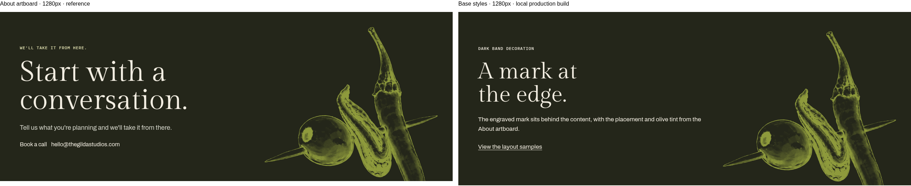
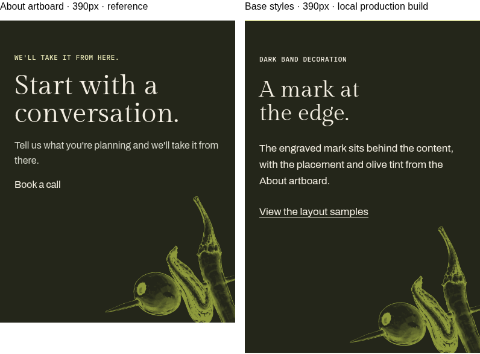

# Base styles visual checks (#6)

Local production build, checked in Chromium on 21 October 2026. The preview page
is `/dev/base-styles/`. Review on the Netlify Deploy Preview is still required.

The comparisons below place the About artboard's dark band next to the base
styles specimen. They check the engraved mask's placement and tint. The full
CTA component belongs to #14. The reference uses the original section markup
and self-hosted fonts without the design canvas runtime; its imported button
appears as plain text. Nothing in `design/` was changed.

## Desktop · 1280

Both marks use a 494×600px box, right 40px, bottom −160px, filled with
`--olive-on-dark` (`#8E9A3C`).

## Phone · 390

Both marks use a 247×300px box, right −30px, bottom −90px, with the same fill.

## Browser checks

Passed on the production build at 390, 768, 1280, 1440 and 1920px:

- All seven band grounds match the design palette, with Brine text on light
  grounds and Cream on dark grounds.
- Body type is Archivo 400 at 17px/1.6. Headings use Gilda Display. Labels use
  IBM Plex Mono 500, uppercase, with 0.06em tracking.
- Links use Olive on light grounds and Cream on dark grounds, with the specified
  hover colour/opacity and a 3px underline offset.
- Keyboard Tab reaches each band link and displays a contrasting 2px outline
  with a 3px offset.
- Opening rules are 2px; row rules are 1px. Light rows use 25% or 20% Brine;
  dark rows use 25% Cream and dark opening rules use 35% Cream.
- The four grid helpers use the expected column counts and stack below 768px.
- Page gutters are 56px on desktop and 24px on phone; the header helper uses
  20px on phone. The wide grid gap changes from 72px to 24px.
- The wide-screen container caps at 1392px, including two 56px gutters. This
  implements the proposed 1280px content cap, pending design sign-off.
- Nested light bands restore light-ground text, links and rule colours.
- No horizontal overflow, JavaScript errors or failed site asset requests.
- The existing homepage and `/dev/fonts/` specimen still render.

## Required checks

- [x] `npm run lint`
- [x] `npm run format:check`
- [x] `npm run check` (zero errors or warnings; one existing ESLint-config deprecation hint)
- [x] `npm run build`
- [ ] Repeat the 1280 and 390 visual comparison on the Netlify Deploy Preview.
- [ ] Confirm the proposed 1280px maximum content width.
