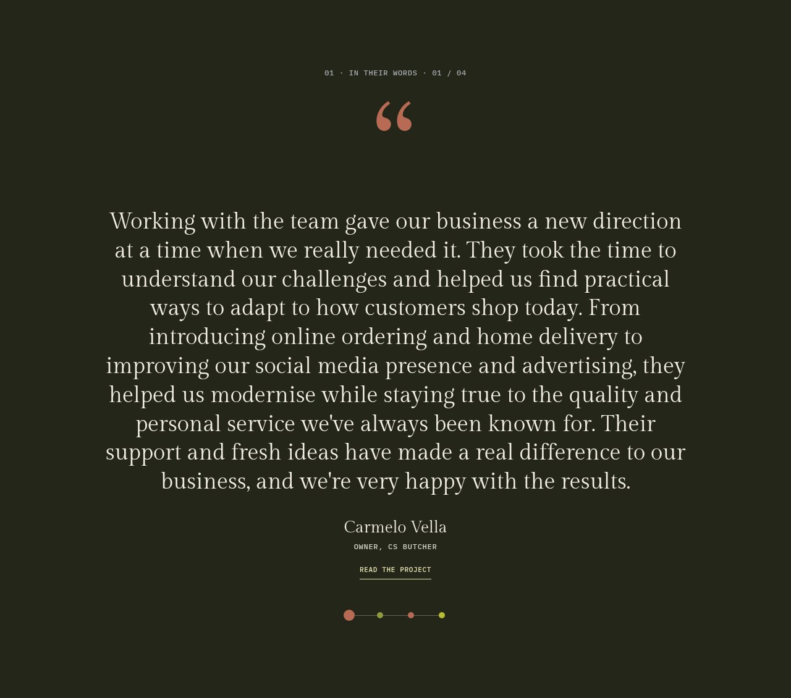
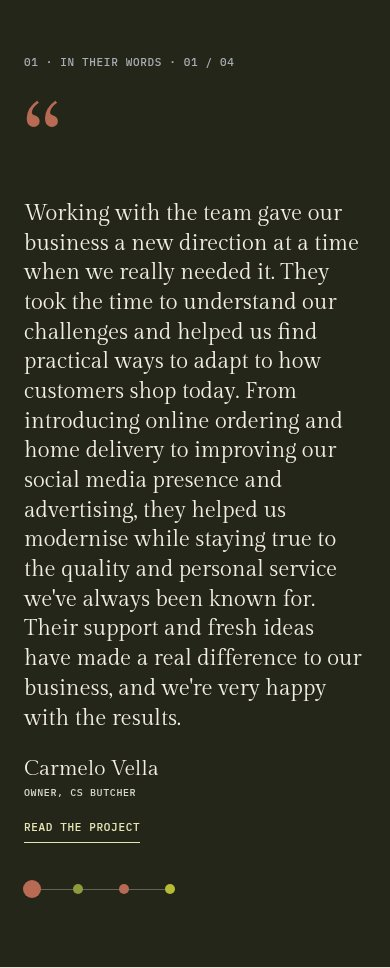
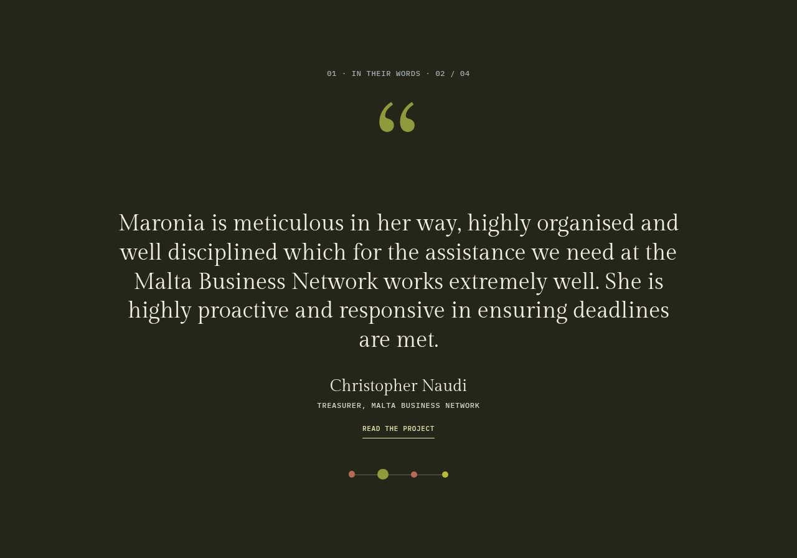
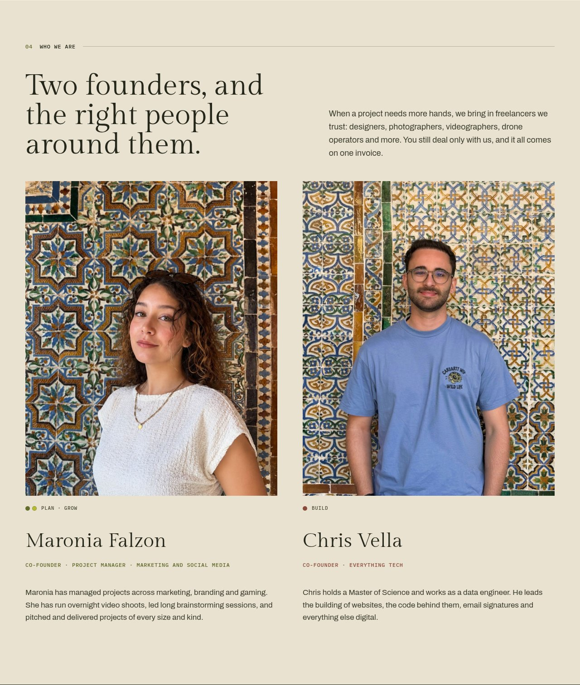
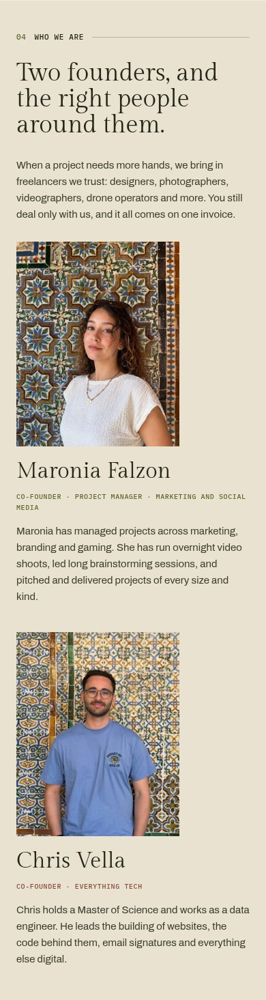
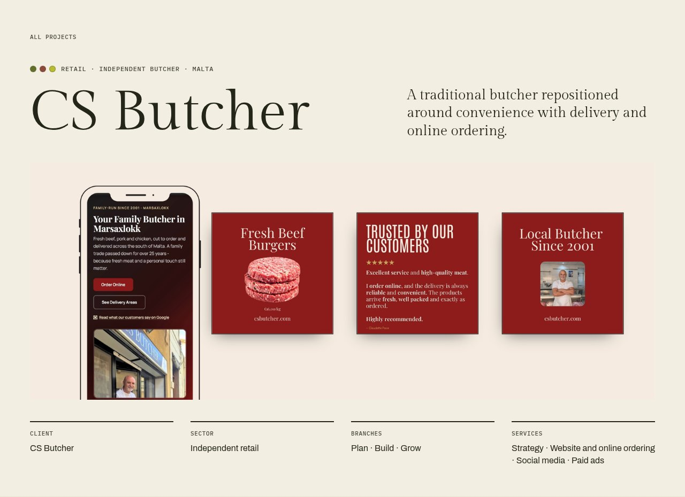
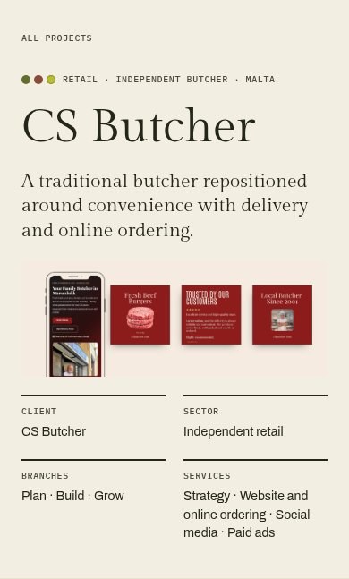

# Responsive fixes (#69–#74)

The owner requested these changes to the existing design on 24 October 2026:
full mobile project images, a testimonial section that fits each quote, manual
dots and phone swipes without playback buttons, no homepage project cards, and
aligned desktop founder photos.

Reference artboards remain unchanged in [Homepage 2a](../../design/Website%20-%20Homepage.dc.html),
[About 1a](../../design/Website%20-%20About.dc.html) and
[Projects](../../design/Website%20-%20Projects.dc.html). The changes above intentionally
supersede their crop ratios, fixed testimonial height, autoplay, Selected work
band and narrow desktop portrait slots.

## Local production screenshots

These captures use the production build in Chromium at 1280px and 390px. They
are local verification; review on the Cloudflare PR preview is still required.

| Section           | 1280px                                                      | 390px                                                     |
| ----------------- | ----------------------------------------------------------- | --------------------------------------------------------- |
| Long testimonial  |         |         |
| Short testimonial |  |  |
| Founders          |                  |                  |
| Project intro     |                 |                 |

## Regression coverage

- `tests/performance/responsive.spec.ts`: all project covers, heroes and galleries
  retain the uploaded proportions at 375px and 390px; founder photos and caption
  rows align at 1280px and 1440px; homepage project previews and playback controls
  are absent; quotes do not advance on a timer; real touch gestures switch in
  both directions and wrap; vertical scrolling and short gestures keep the
  active quote; all quotes remain visible without JavaScript.
- `tests/performance/layout.spec.ts`: the slide area fits each selected quote
  and changes height for different quote lengths at 390px and 1280px. Initial
  page loads still produce zero layout shift.
- `tests/a11y/a11y.spec.ts`: keyboard dots announce their selected quote, inactive
  links are hidden, and reduced motion never triggers autoplay.
