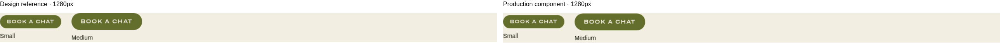
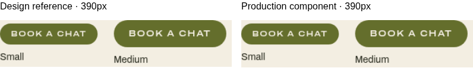
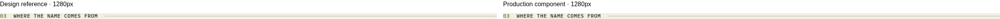
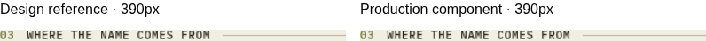
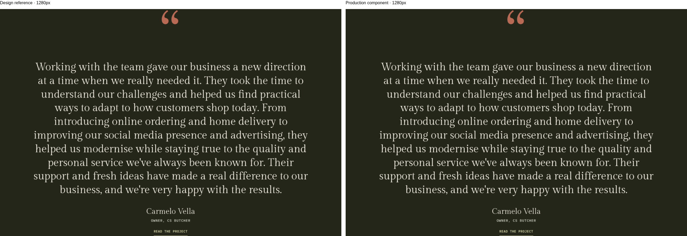
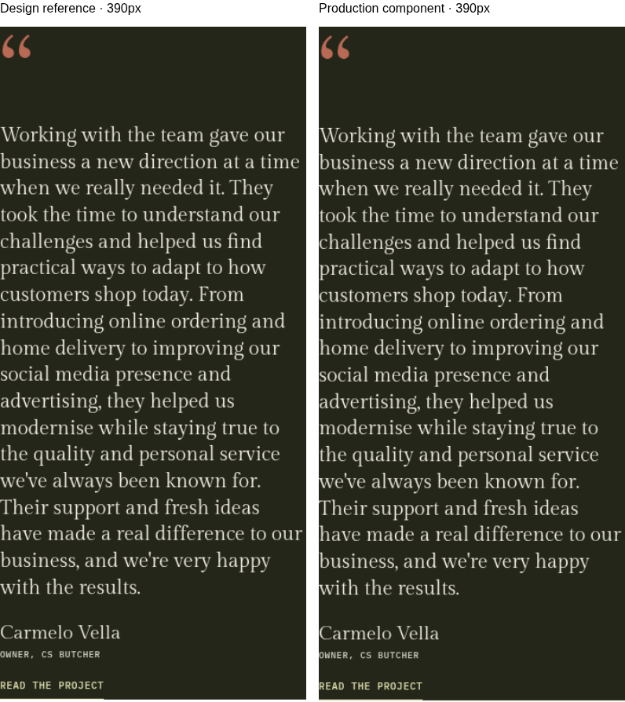
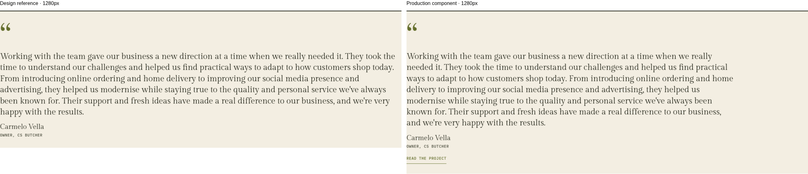
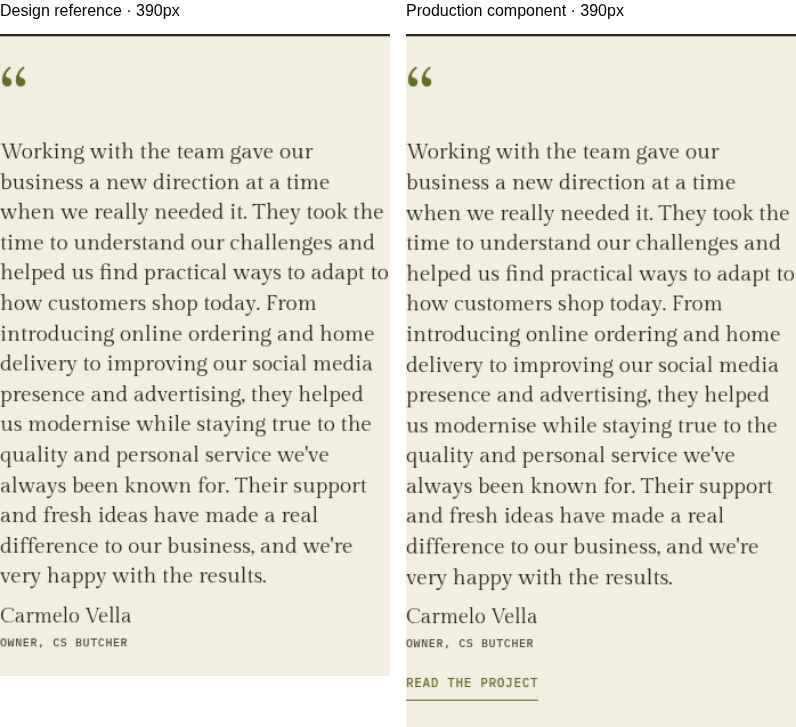

# Shared components visual checks (#7, #11, #13)

Local production build, checked in Chromium on 21 October 2026. The user
approved including dependent issues once their prerequisites are implemented
in this branch. This batch builds on #6 in the same PR.

| Issue | Preview                                     |
| ----- | ------------------------------------------- |
| #7    | `/dev/button/`, `/dev/label/`, `/dev/chip/` |
| #11   | `/dev/section-header/`                      |
| #13   | `/dev/testimonial/`                         |

The comparisons pair reference fragments from the immutable design export with
the production component at the same available width. References use the
self-hosted fonts. Homepage references use approved option 2a. Outer section
padding and rotator controls belong to the parent layouts.

## Button

The reference renders `Button` from `_ds_bundle.js` with its initial static
state. Its small and medium faces match the production component. The preview
includes all six variants, both sizes, action buttons and disabled controls.

## SectionHeader

These are the “Where the name comes from” instances in the Homepage artboards.
The preview also includes Selected work with its optional link, the three About
labels, and the unnumbered Anchovy “SIX PHASES” label on Cream, Sand and Brine.
Tracking follows the page artboards at 0.06em.

## Testimonial · dark

Homepage 2a, using Carmelo Vella's original quote. Name, business, typography,
mark tint, spacing and project-link styling follow the artboard.

## Testimonial · light

Projects 1b, using the same original client words. The component adds the
project link required by #13. Phone type follows that artboard: 19px quote,
72px mark and 18px name.

## Verification

- All six button variants and both sizes appear in the Cream and Brine previews,
  with suitable swatches for outline variants. Label previews cover all tones,
  both sizes and both tracking values. Chip previews cover all three variants.
- Buttons render Archivo 600 at 125% width: the sample text measured 121.86px,
  compared with 96.48px at 100% width using the same 12px type size.
- Hover reaches 86% opacity over 150ms; reduced motion changes instantly.
  Disabled buttons and links use 40% opacity. Disabled anchors have no
  destination and leave the tab order. Action buttons do not submit forms by
  default.
- Touch buttons and toggle chips are at least 44px tall, checked with a coarse
  pointer at 390px.
- Enter and Space change a toggle's `aria-pressed` state and emit the expected
  `chip-change` event. Reconnecting an island retains one listener.
- Static chips, buttons, labels, section headers and testimonials ship no
  JavaScript. The toggle island is loaded when toggle chips render.
- At 390, 768, 1280 and 1440px, all 18 header specimens have native heading
  semantics, 1px hairlines, correct tracking and visible link focus. A supplied
  heading ID works as a section's `aria-labelledby` target.
- Both testimonial variants use `figure`, `blockquote` and `figcaption`.
  Accessibility snapshots contain each quote and attribution once, with the
  decorative mark excluded. Role and business props both render correctly.
- Client quote text and attribution were compared verbatim with the design's
  data. Generated links and citations match the case-study slugs specified in
  #25 (`cs-butcher` and `malta-business-network`). The destination pages will
  be created in #25; HTTP resolution is reviewed with that issue.
- All previews fit the checked viewports without horizontal overflow or
  JavaScript errors. The base-style page, homepage and font specimen still
  render.

## Remaining review

- [ ] Repeat the 1280 and 390 visual checks on the Netlify Deploy Preview.
      This cloud environment blocks the preview host with HTTP CONNECT 403.
- [ ] Confirm #6's proposed 1280px content cap on wider screens.
