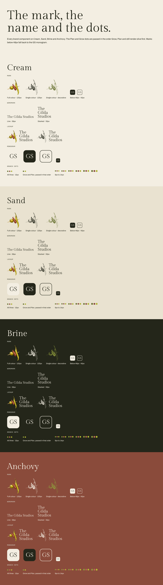
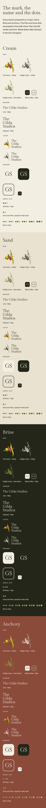
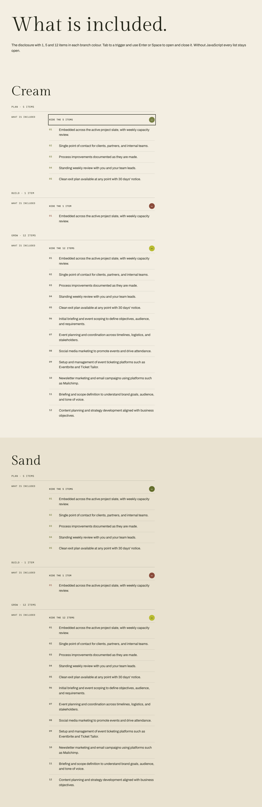
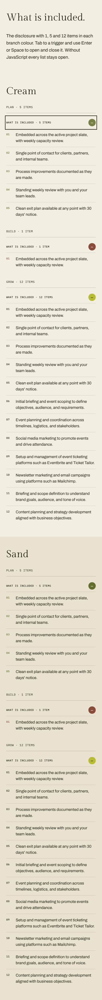
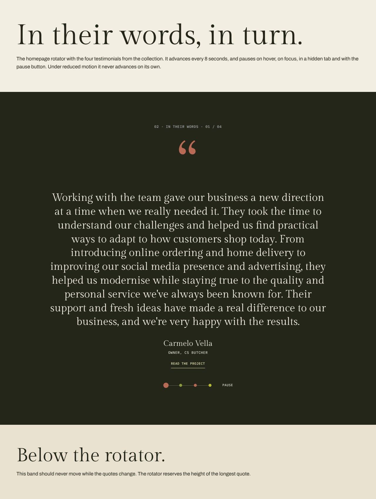
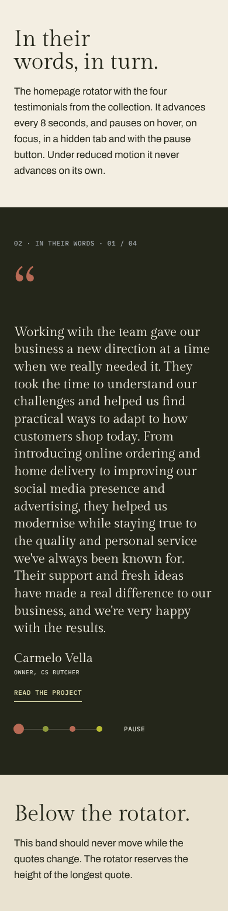

# Brand components, disclosure and rotator checks (#8, #12, #18)

Local production build, checked in Chromium (Playwright) at 1280 and 390 on
22 October 2026. Final screenshots still need checking on the Netlify Deploy
Preview.

| Issue | Preview                     |
| ----- | --------------------------- |
| #8    | `/dev/brand/`               |
| #12   | `/dev/disclosure/`          |
| #18   | `/dev/testimonial-rotator/` |

## Brand (#8)

Every component on Cream, Sand, Brine and Anchovy. The Plan and Grow dots are
passed as `['grow', 'plan']` and render olive first. Pepper dots carry the inset
ring on Cream and Sand. Brine and Anchovy use the on-dark tints. The 40px marks
render the GS monogram instead. The lockup measures 96px / 32px at 1280 and
72px / 26px at 390, as in the 2a footer.

## Disclosure (#12)

The Services 1a "What is included" row with 1, 5 and 12 items, shown open.
The desktop trigger reads "SHOW ALL {n} ITEMS" / "HIDE THE {n} ITEMS". On phone
it reads "WHAT IS INCLUDED · {n} ITEMS". Grow uses a pepper circle with a Brine
sign and Brine numbers.

Scripted checks: Tab reaches the trigger. Enter opens it and Space closes it,
updating `aria-expanded`. The accessible name includes the count. The closed
panel has no height and is hidden from assistive technology. Content above the
component does not move. Reduced motion removes the transition. Without
JavaScript the list renders open and the trigger is replaced by a static label.

## Testimonial rotator (#18)

Homepage 2a "02 · IN THEIR WORDS". All four quotes share one grid cell, so the
section takes the height of the longest quote. Scripted checks, using a fake
clock:

- It autoplays every 8 seconds, wraps from 04 to 01 and makes no announcement.
- The dot, the counter and the quote-mark colour change together.
- It pauses on hover, on focus within, with the pause button and while the tab
  is hidden, then resumes afterwards.
- Under `prefers-reduced-motion` it never advances, and the pause control is
  hidden.
- Enter and Space work on the dots, and Tab reaches the pause button. A dot
  change announces "Testimonial 3 of 4: Joseph Zammit Tabona" politely.
- The band below never moves, and the measured CLS from page load is 0 at
  both widths.
- Without JavaScript, all four quotes are listed and the controls are hidden.

