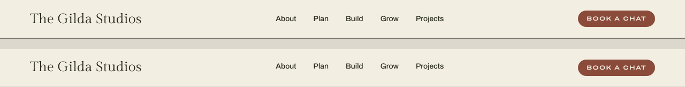
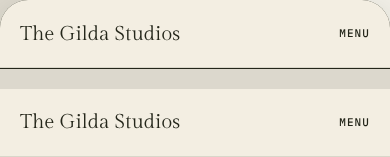
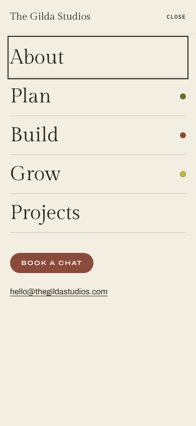

# Site header checks (#9)

Local production build, checked in Chromium (Playwright) on 22 October 2026.
Preview: `/dev/header/`. Every page that uses `Base.astro` now has the header.

## Against the artboards

In each image, the top strip is the Homepage 2a artboard header and the bottom
strip is the build. The bar heights match: 72px at 1280 and 68px at 390.

## Mobile menu (proposal)

The open menu isn't in the design. It fills the screen and repeats the bar,
with CLOSE exactly where MENU was. The panel lists the nav links in Gilda
Display at 40px, separated by 1px rules, with the branch dot beside Plan, Build
and Grow. The Book a chat button and the email address follow.

## Scripted checks

- From 960px up, the nav and the Book a chat button show. Below that, only the
  MENU toggle shows, with a 44px touch height and the wordmark at 20px below
  768px. Nav hover turns olive.
- Tab reaches the toggle, and Enter or Space opens the menu. `aria-expanded`
  becomes true, the label reads CLOSE, and focus moves to the first link.
- Tab and Shift+Tab cycle inside the menu. Esc or CLOSE closes it, and focus
  returns to the toggle, which reads MENU again.
- The page behind is inert and doesn't scroll. Opening and closing the menu
  causes no layout shift (CLS 0). Widening to desktop closes it.
- Under reduced motion the menu opens without the fade.
- Without JavaScript, the phone header wraps the links under the name.
- The current page is olive with a 2px rule. On Services, Plan, Build and Grow
  take their branch colours, and Grow is brine text over a pepper rule. Case
  studies mark Projects with `aria-current="true"`.
